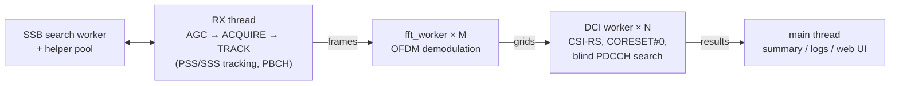

# 5G-GoldenSniffer-cpp

[](LICENSE)

A real-time passive 5G NR downlink control channel sniffer for Ettus USRP software-defined radios.

It receives a cell with a USRP (or replays an IQ recording), finds and tracks the SS block, decodes the MIB,
and **blindly detects and decodes every PDCCH DCI in every frame**, with no knowledge of the RRC
configuration and no list of RNTIs. For each DCI it recovers the **RNTI**, the DM-RS scrambling ID, the
aggregation level and the payload size. It also detects TRS and other NZP-CSI-RS.

| | |
|:--|:--|
| UE DCIs detected on the Zenodo dataset, scored against the gNB logs | **99.79 %** (99.996 % once locked) |
| Speed, 20 MHz cell | about **15×** real time |
| Speed, 80 MHz commercial n78 carrier | about **2.7×** real time |

**Documentation:** <https://5g-goldensniffer.github.io/5G-GoldenSniffer/> ·
**Zenodo dataset:** <https://zenodo.org/records/21678295> .

---

## Contents

- [Features](#features)
- [How it works](#how-it-works)
- [Requirements](#requirements)
- [Build](#build)
- [Usage](#usage)
- [Web dashboard](#web-dashboard)
- [Repository layout](#repository-layout)
- [Limitations](#limitations)
- [License](#license)

## Features

- **Cell search and tracking.** Searches every GSCN of the band for the SS block (all 3 PSS × 336 SSS
  hypotheses), estimates CFO and frame timing, then tracks frequency and timing with PI loops.
- **Broadcast channel.** Decodes the PBCH with a CRC-aided polar list decoder (L = 8) to get the MIB, the SFN
  and the CORESET#0 configuration.
- **Blind PDCCH decoding.** Interleaved and non-interleaved CORESETs, CORESET#0, aggregation levels 1–16,
  CORESET durations of 1 and 2 symbols.
- **Reference signals.** Detects TRS and other NZP-CSI-RS and recovers their scrambling identity.
- **Fallback DCI fields.** Parses formats 0_0 and 1_0 (frequency allocation, MCS, RV, TBS) and estimates the
  DL/UL throughput per RNTI.
- **Outputs.** A console summary per second, a raw per-DCI log, one log file per RNTI, and an optional live
  web dashboard.
- **Configurations.** FR1, SS block Case A (15 kHz) and Case C (30 kHz), FDD and TDD, tested up to an 80 MHz
  carrier. USRP N310, X310, X410, B200mini and B210, or IQ files (`sc16`, `fc32`).

## How it works

Blind decoding is cheap because of three ideas:

- **No RNTI search.** The PDCCH DM-RS is a Gold sequence whose initial state depends on the scrambling
  identity. Inverting the scrambling on the received DM-RS gives the identity directly, instead of trying
  the 2<sup>16</sup> possibilities.
- **One linear solve per candidate.** CRC, polar encoding, rate matching and scrambling are affine over
  GF(2). A single precomputed solve per candidate gives both the DCI payload and the RNTI that masks the
  CRC; an inconsistent system rejects the candidate, often after a few rows.
- **Few hypotheses.** Only the clusters of busy subcarriers in each slot become candidates, so a slot needs
  only a few decodes.

The receiver is a multi-threaded pipeline with pinned, real-time threads:



## Requirements

- Linux and a C++17 compiler (`g++`)
- [UHD](https://github.com/EttusResearch/uhd) (USRP driver)
- Boost `program_options`
- FFTW3, single precision (`fftw3f`)
- `pkg-config`

On Debian or Ubuntu:

```bash
sudo apt install build-essential pkg-config libuhd-dev libboost-program-options-dev libfftw3-dev
```

A USRP is needed only for live reception; IQ recordings can be replayed without one.

## Build

```bash
make            # build ./main
make clean      # remove the binary and the object files
make again      # clean, then build
make WEBUI=1    # also build the --webui output for the dashboard
```

Build options live in `config.mk` and can be overridden on the command line; changing one rebuilds what it
affects, without `make clean`. The build uses `-O3 -march=native -flto` (link-time optimization is needed
for performance).

At the end, `make` runs `sudo setcap cap_sys_nice=ep main` so that the program can give its threads
real-time priority; you are asked for your password once per build.

At start-up `main` self-tests the PBCH decoder and the DCI codec, and exits if either fails.

## Usage

### Live reception

Device arguments are passed to UHD unchanged. Keep them in a small file:

```bash
cp device-args.example my-usrp      # fill in serial, address, master clock rate
./main $(cat my-usrp) --freq-rx 3650e6 --bandwidth 30e6
```

`--freq-rx` and `--bandwidth` are in **Hz**. The subcarrier spacing follows from the frequency (30 kHz
above 3 GHz, 15 kHz below); `--mu 1` selects a 30 kHz SS block below 3 GHz (e.g. band n41). `--freq-rx` must
be an integer number of subcarriers away from a GSCN of the band, otherwise it is moved to the closest
frequency that is. Stop with <kbd>Ctrl</kbd>+<kbd>C</kbd>.

### Replaying a recording

```bash
./main --file capture.sc16 --freq-rx 1980e6 --bandwidth 20e6 --rate 23.04e6
```

`--format sc16|fc32` sets the sample format (default: from the file extension) and `--rate` the file sample
rate (default: the rate a USRP would use). The AGC is skipped, no samples are skipped during the search, and
the program exits at the end of the file after draining the pipeline.

### Example output

```text
Cell found: PCI 1007, SSB at 1972.950 MHz, SIR 22.7 dB
MIB: SFN 642, SS block #0 in half frame 0, SCS common 15 kHz, k_SSB 10, DM-RS type A position 2, cell not barred, pdcch-ConfigSIB1 1/0
CORESET#0: 24 RB x 2 symbols, 2 RB below the SS block, subcarriers 12..299 of the grid; Type0-PDCCH in slots 0,1 of even frames from symbol 0
17:46:45 +0s  TRACK  PCI 1007 @ 1972.950 MHz  SSB in 38/95 frames  SFN 735  SNR 23.5 dB  CFO +1609 Hz  SFO +0.00 ppm  [acquired]
    95 frames, PDCCH in 519/950 slots, 613 DCIs (DL 225, UL 388) from 1 RNTIs
    RNTI 0x4601         scrID 0x03ef    613 DCIs  DL   225  UL   388
```

### Main options

Run `./main --help` for the full list with the current defaults.

| Option | Meaning |
|:--|:--|
| `--args` | USRP device arguments |
| `--file`, `--format`, `--rate` | replay an IQ file instead of a USRP |
| `--freq-rx`, `--bandwidth` | RX frequency and bandwidth, Hz |
| `--mu 0\|1` | numerology override |
| `--min_SSB_SIR` | minimum SS block SIR to start tracking, dB |
| `--workers`, `--fft-threads`, `--acq-threads` | thread counts |
| `--rx-cpus`, `--worker-cpus` | CPU pinning (`taskset -c` syntax, or `all`) |
| `--dci-sizes 39,41,...` | DCI payload sizes tried by the blind search |
| `--fallback BWP` | parse fallback DCIs for a BWP of this many RBs |
| `--estimate-throughput` | DL/UL throughput estimate per RNTI (needs `--fallback`) |
| `--verbose` | one line per DCI, CSI-RS and tracked frame instead of the summary |
| `--rnti-log` | one log file per RNTI in `logs-<timestamp>/` |
| `--webui [host:]port` | send the summary as JSON over UDP (needs `make WEBUI=1`) |

The default CPU pinning (`--rx-cpus 0-6:2`, `--worker-cpus 8-14:2,16-31`) suits a 16 P-core + 16 E-core
CPU; on other machines set both lists for your cores and keep them disjoint, since the RX thread runs at
real-time priority. See [Usage](https://5g-goldensniffer.github.io/5G-GoldenSniffer-cpp/usage) for all the
options and the output formats.

## Web dashboard

With a build made with `WEBUI=1`, `--webui [host:]port` sends each per-second summary as a JSON datagram.
`webui/server.py` (standard-library Python) bridges it to a browser dashboard:

```bash
make WEBUI=1
python3 webui/server.py &                      # UDP 127.0.0.1:9870 -> http://127.0.0.1:8080/
./main --file capture.sc16 --freq-rx 1980e6 --bandwidth 20e6 --webui 9870
```

`webui/mock_sender.py` generates synthetic data for working on the UI without a radio. The JSON schema and
the server options are documented in [webui/README.md](webui/README.md).

## Repository layout

| Path | Contents |
|:--|:--|
| `main.cpp` | option parsing, RX loop and receiver state machine |
| `acquisition.*`, `gscn.*` | SS block search, frequency raster |
| `pbch.*`, `polar.*` | PBCH/MIB decoding, CORESET#0 tables, polar codec |
| `ofdm.*`, `dci_scan.*` | OFDM demodulation, frame processing and blind PDCCH search |
| `DCIfactory.*`, `gf2solve.*`, `NRscrambling.*` | GF(2) DCI decoder, binary linear algebra, Gold sequences |
| `fallback_dci.*` | format 0_0 / 1_0 field parsing and TBS |
| `summary.*`, `rnti_log.*`, `webui.*` | console summary, per-RNTI logs, UDP JSON output |
| `pipeline.h` | queues and buffer pool |
| `webui/` | dashboard, UDP→SSE bridge, mock sender |
| `docs/` | documentation site (GitHub Pages) |
| `report/` | technical report, its data and the evaluation scripts |

## Limitations

The receiver targets a line-of-sight installation with a high SNR:

- **Hard decisions.** DM-RS identity recovery and the GF(2) decoder need an error-free candidate, which is
  much less sensitive than a soft-decision polar decoder.
- **Phase unwrapping** assumes less than 45° of channel phase change between adjacent subcarriers.
- CORESET durations of 3 symbols are not searched.
- Adjacent REG bundles of different DCIs in interleaved CORESETs can merge into runs that cannot be split.
- About once in 10<sup>3</sup>, an AL1 DCI is also a consistent solution for a nearby size, giving a wrong
  RNTI.
- No Case B SS block, no `rb-Offset-r16`, no NZP-CSI-RS with CDM; only fallback DCIs are parsed. PDSCH
  decoding, non-fallback DCI layouts and multi-antenna combining are not implemented.

## License

MIT, see [LICENSE](LICENSE).
